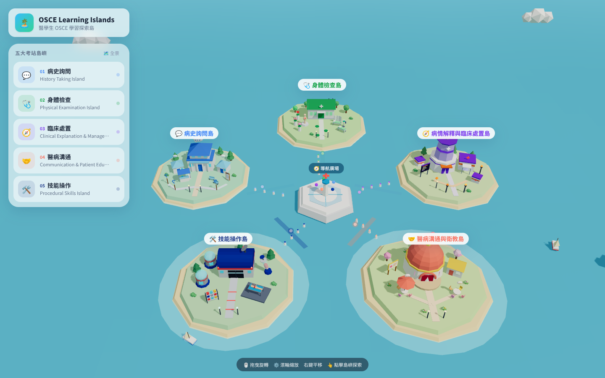

# OSCE Learning Islands｜醫學生 OSCE 學習探索島

第一階段：3D 群島視覺骨架與基礎互動。

🌐 線上版：https://luyun1224.github.io/osce-island/



技術：React 18 · Vite 5 · TypeScript · Three.js · React Three Fiber · Drei · Tailwind CSS

## 本機執行

需求：Node.js 18 以上（建議 20 / 22）

```bash
npm install
npm run dev        # 開發模式 http://localhost:5173（同網段手機可用顯示的 Network 位址測試）
npm run build      # 產出 dist/
npm run preview    # 預覽正式版
```

## 部署（GitHub Pages）

推送到 `main` 後，`.github/workflows/deploy.yml` 會自動建置並發布到 GitHub Pages（約 1–2 分鐘）。
首次使用需在 repo 的 **Settings → Pages → Build and deployment → Source** 選擇 **GitHub Actions**。

## 操作方式

| 動作 | 桌機 | 手機 |
| --- | --- | --- |
| 旋轉視角 | 左鍵拖曳 | 單指拖曳 |
| 縮放 | 滾輪 | 雙指捏合 |
| 平移 | 右鍵拖曳 | 雙指拖曳 |
| 選擇島嶼 | 點擊島嶼 / 建築 / 左側選單 | 點擊島嶼 / 上方膠囊選單 |
| 返回全景 | 「返回全景」按鈕、Esc、點中央廣場、雙擊海面 | 「全景」按鈕、點中央廣場 |

## 專案結構

```
src/
├── types/island.ts                 # 型別：IslandConfig、IslandTheme、LearningModule…
├── data/islandData.ts              # IslandData：五座島設定、鏡頭參數（改內容只需改這裡）
├── components/
│   ├── scene/
│   │   ├── IslandMapScene.tsx      # Canvas、燈光、霧、組合整個場景
│   │   ├── CameraControls.tsx      # OrbitControls + 平滑飛行聚焦 / 全景
│   │   ├── Island.tsx              # 通用島嶼：地基、hover 浮起、光環、點擊、標籤
│   │   ├── CentralPlaza.tsx        # 中央導航廣場
│   │   ├── SeaRoutes.tsx           # 發光航線、浮標、流動光點
│   │   ├── Ocean.tsx               # Low Poly 動態海面
│   │   ├── Ambience.tsx            # 雲、小船
│   │   ├── primitives.tsx          # Low Poly 共用幾何（Box、Tree、Heart、MedCross…）
│   │   └── buildings/
│   │       ├── index.ts            # 建築註冊表 BUILDING_REGISTRY（島 ID → 建築元件）
│   │       ├── HistoryTakingBuildings.tsx       # 病史詢問學院
│   │       ├── PhysicalExamBuildings.tsx        # 身體檢查訓練館
│   │       ├── ClinicalManagementBuildings.tsx  # 臨床處置決策中心
│   │       ├── CommunicationBuildings.tsx       # 醫病溝通劇場
│   │       └── ProceduralSkillsBuildings.tsx    # 技能操作中心
│   └── ui/
│       ├── NavigationMenu.tsx      # 快速導航（桌機左側 / 手機上方）
│       ├── IslandCard.tsx          # 導航選單中的島嶼卡片
│       ├── IslandInfoPanel.tsx     # 島嶼介紹面板（桌機右側 / 手機底部抽屜）
│       └── Overlay.tsx             # 頁首、操作提示、Toast
├── App.tsx                         # 狀態：selectedId / hoveredId
└── main.tsx
```

## 如何修改

- **改島嶼名稱、簡介、顏色、位置**：只改 `src/data/islandData.ts`。
- **調整某島建築**：改 `components/scene/buildings/` 中對應檔案；建築正面朝 +Z，島面高度 y = 0，可用半徑約 `radius - 1.5`。
- **新增第六座島**：在 `IslandId` 加入新 ID → `ISLANDS` 加一筆設定 → 新增建築元件並註冊到 `BUILDING_REGISTRY`。
- **調整鏡頭**：`OVERVIEW_CAMERA`、`DEFAULT_FOCUS_OFFSET`，或在單島設定 `cameraOffset`。

## 後續擴充建議

1. **路由**：加入 `react-router`，`/` 為群島、`/island/:id` 為島內學習區；「進入學習區」目前在 `App.tsx` 的 `handleEnter` 顯示提示，之後改成導頁即可。
2. **學習內容資料**：`IslandConfig.modules`（`LearningModule`）已預留，可擴充為教案（病人設定、SP 劇本、評分表）、技能步驟清單、測驗題；建議先以 `src/data/modules/<islandId>.ts` 或 JSON 管理，之後再換成 API。
3. **島內場景**：每座建築可以變成可點擊的「考站入口」（例如點檢查床進入身體檢查流程），在建築元件上加 `onClick` 並把熱點座標放進資料檔。
4. **學習進度視覺化**：在 `Island` 加上進度旗幟 / 完成徽章，使用 `localStorage` 或 zustand 先做本機進度，再接後端。
5. **狀態管理**：互動變多時，將 `selectedId` 等狀態移到 zustand（R3F 生態常用）。
6. **效能**：裝飾物數量大增時改用 `Instances` / `Merged`（drei）；需要時以 `React.lazy` 分割島內頁面，降低首屏 bundle。
7. **無障礙與多語**：標題 / 簡介已集中在資料檔，之後可加 `i18n` 與鍵盤導覽。
